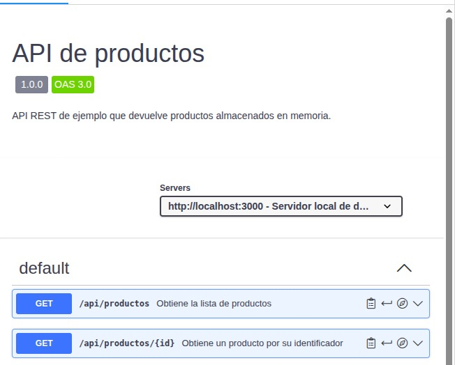

# API

## ¿Qué es OpenAPI?

OpenAPI es un estándar, independiente del lenguaje de programación, para **describir** una API REST:
qué rutas tiene, qué métodos HTTP admite, qué parámetros recibe y qué respuestas puede devolver.
La descripción se guarda en un fichero YAML o JSON. En este proyecto es openapi.yaml, en la raíz del repositorio.

Este fichero no ejecuta ni implementa la API: solo la describe. La API real está en app.js.

## ¿Para qué sirve Swagger UI?

Swagger UI es una herramienta que lee un fichero OpenAPI y lo convierte en una **documentación web visual e interactiva**.
Permite ver los endpoints, sus parámetros y sus respuestas, y puede usarse para probarlos.
Se ha utilizado Swagger Editor para escribir y validar el fichero, y Swagger UI para visualizarlo.

## Endpoints

| Método | Ruta                  | Descripción                          | Respuestas |
|--------|-----------------------|--------------------------------------|------------|
| GET    | /api/productos      | Devuelve la lista de productos       | 200      |
| GET    | /api/productos/{id} | Devuelve un producto por su id (entero) | 200, 404 |

## Documentación visualizada

El fichero completo está en [openapi.yaml](https://github.com/Xeto807/api-productos-a14/blob/main/openapi.yaml).