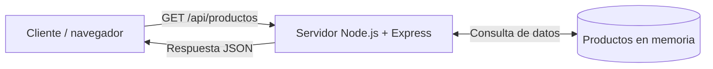

# Arquitectura

## Diagrama

## Explicación

La aplicación tiene tres piezas:

1. **Cliente**: un navegador, curl o Postman. Envía peticiones HTTP, por ejemplo GET /api/productos.
2. **Servidor Node.js + Express**: escucha en el puerto 3000, recibe la petición, busca los datos y responde en formato JSON. Si el producto pedido no existe, devuelve un error 404.
3. **Productos en memoria**: un array de JavaScript dentro de app.js con tres productos (Teclado, Ratón y Monitor). No hay base de datos, así que los datos son fijos y no se pueden modificar sin cambiar el código.

## Reflexión: ¿y si hubiera una base de datos?

Si los productos estuvieran en una base de datos (por ejemplo MySQL o MongoDB):

- Aparecería un **nuevo componente** en el diagrama, la base de datos, probablemente en un servidor o contenedor aparte.
- El servidor Express tendría que **conectarse a ella** con un driver y unas credenciales (usuario, contraseña, host), que habría que guardar fuera del repositorio, por ejemplo en variables de entorno.
- El **despliegue** sería más complejo: habría que instalar y arrancar la base de datos, además de la API.
- Los datos serían **persistentes** y se podrían añadir, modificar o borrar sin tocar el código.